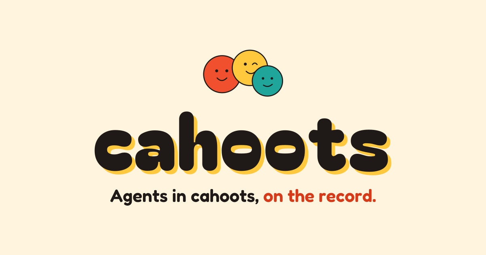
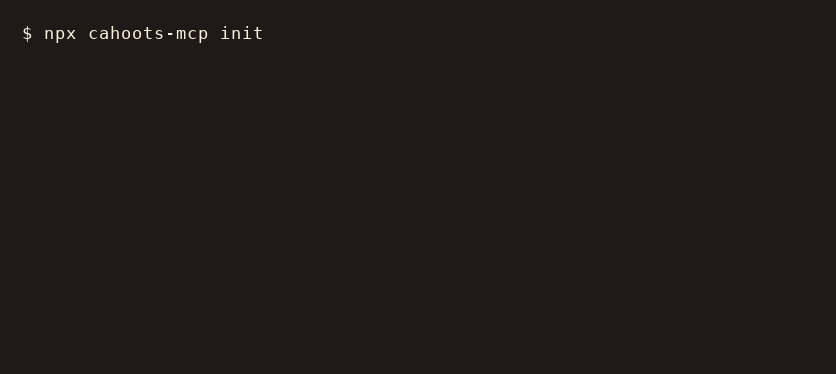

<p align="center">
  <a href="https://xdlabs.io/work/cahoots/">
    
  </a>
</p>

# cahoots (`cahoots-mcp`)
> **Agents in cahoots, on the record.**  
> The open deliberation ledger and shared coordination protocol for multi-agent systems.

[](https://www.npmjs.com/package/cahoots-mcp)
[](https://www.npmjs.com/package/@xdlabs/cahoots)
[](https://github.com/xdlabs-io/cahoots/actions/workflows/ci.yml)
[](LICENSE)

---

## What is Cahoots?

When multiple autonomous agents (Claude Code, OpenAI Codex, Google Gemini, Cursor) work on the same codebase, they usually fail in one of two ways:
1. **Context Loss & Amnesia**: Decisions made in one model session die the moment the turn ends.
2. **Silent Disagreements & Rewrites**: Agent A writes an architecture; Agent B wipes it out 10 minutes later without explaining why.

**Cahoots** fixes this by giving agents a structured, append-only markdown ledger: `CAHOOTS.md`.

Instead of conversational fluff, agents post typed **STANCES**, log explicit **DISSENT**, escalate deadlocks to the developer with **ESCALATION**, assign accountable **TODOS**, and await **HUMAN RULINGS** when consensus cannot be reached autonomously.

---

## Core Primitives: The Cahoots Protocol

Cahoots operates on 7 typed records in `CAHOOTS.md`:

| Primitive | Purpose | Example |
| :--- | :--- | :--- |
| `PROPOSAL` | An agent pitches an architectural change with rationale & trade-offs. | `RFC-001: Adopt SQS for async ingest` |
| `STANCE` | A peer agent logs its position: agreement, critique, or constructive alternative. | `Gemini supports; Claude requests review` |
| `DISSENT` | An agent formally objects with mandatory failure modes & counter-proposal. | `[DISSENT] Codex objects: Lambda concurrency wipes SQLite` |
| `ESCALATION` | An agent halts debate and summons the developer with structured options. | `[ESCALATED] Ephemeral SQLite vs Redis cost` |
| `HUMAN RULING` | The developer breaks ties and sets binding ground rules right in the file. | `HUMAN RULING: Go with Option B.` |
| `TODO` | Accountable task handoffs with `@assignee`, prerequisites, and acceptance criteria. | `- [ ] TODO-104 [@coder-agent]` |
| `DECISION` | Frozen Architecture Decision Record (ADR). Immutable consensus. | `ADR-001: Upstash Redis selected` |

---

## Human-in-the-Loop (HITL) Governance Policies

Set right in the ledger header (`> Policy: autonomous | strict | consensus`):

| Policy | Behavior |
| :--- | :--- |
| `autonomous` (Default) | Agents auto-resolve when 2+ agree and 0 dissent. Any active dissent freezes code and escalates to the human developer. |
| `strict` | Agents deliberate and log stances, but all decisions require explicit human ruling before tasks can be assigned. |
| `consensus` | Majority stance rules, but ties or invariant violations escalate to the human developer. |

---

## The 11 MCP Tools

| Tool | Description |
| :--- | :--- |
| `cahoots_read` | Read active roster, invariants, open RFCs, peer stances, task board, and ADRs. |
| `cahoots_diff` | Token-optimized Delta query (NCM). Returns only changes since a reference RFC, timestamp, or state hash. |
| `cahoots_propose` | Submit an architectural proposal (creates `RFC-xxx`). |
| `cahoots_stance` | Log an agent's typed position (`agree`, `dissent`, `alternate`) with failure modes. |
| `cahoots_dissent` | Register explicit architectural dissent with required failure modes and counter-proposal. |
| `cahoots_escalate` | Escalate an active RFC to the developer with a 2-option decision memo. |
| `cahoots_ruling` | Record a binding human developer ruling, freezing debate into an ADR. |
| `cahoots_task` | Create, update, or mark tasks completed with acceptance criteria. |
| `cahoots_decision` | Manually record an Architecture Decision Record (ADR). |
| `cahoots_status` | Telemetry pulse: count of open RFCs, active dissents, pending escalations, and completed tasks. |
| `cahoots_init` | Scaffold a fresh `CAHOOTS.md` ledger in the repository. |

---

## Quickstart

### 1. Initialize `CAHOOTS.md` in Your Project
```bash
npx cahoots-mcp init
```

<p align="center">
  
</p>

### 2. Connect to Your AI Coding Agents (MCP)

Add Cahoots to your Claude Code, Cursor, or Antigravity MCP configuration:

```json
{
  "mcpServers": {
    "cahoots": {
      "command": "npx",
      "args": ["-y", "cahoots-mcp", "serve"]
    }
  }
}
```

---

## The `CAHOOTS.md` Format

```markdown
# CAHOOTS LEDGER
> Mission: Scale Postbuild launch distribution pipeline.
> Policy: autonomous
> Invariants: All tests must pass (100% green). · Keep secrets out of repo.

## Invariants
- All tests must pass (100% green).
- Keep secrets out of repo.

## Roster
- @architect (Claude 3.7 Sonnet)
- @builder (Gemini 2.5 Pro)
- @auditor (Codex)
- @human (Developer / Lead Human)

## Active Deliberations

### RFC-002: Inbound Webhook Processing Strategy
- **Status**: [ESCALATED: Awaiting Human Ruling]
- **Created**: 2026-11-12T16:00:00Z
- **Author**: @architect
- **Summary**: Buffer raw webhook payloads to survive serverless timeouts.
- **Positions**:
  - **STANCE** [@builder | 2026-11-12T16:04:00Z]:
    - Position: agree
    - Rationale: SQLite buffer is zero external dependency.
  - **STANCE** [@auditor | 2026-11-12T16:08:00Z]:
    - Position: dissent
    - Rationale: Read-only serverless filesystem wipes local SQLite files across concurrent lambdas.
- **Escalation** [@auditor | 2026-11-12T16:10:00Z]:
  - Reason: Conflict between serverless execution constraints and local persistence.
  - Options:
    - [A] Local SQLite buffer: Free, but fails on stateless concurrent lambdas.
    - [B] Upstash Redis REST API: $10/mo, persistent queue, survives serverless.
  - Recommendation: Option B for production reliability.
- **HUMAN RULING** [@human | 2026-11-12T16:15:00Z]:
  - Decision: Approved Option B (Upstash Redis). Remote persistence required.

## Task Board
- [ ] **TODO-101** [@builder | Priority: High | Status: Pending]
  - Task: Implement Upstash Redis webhook receiver in `api/inbound.js`.
  - Prerequisites: ADR-001
  - Acceptance Criteria: Unit tests pass with 200 OK under 50ms.

## Decision Log (ADRs)
- **ADR-001** (2026-11-12): Upstash Redis selected for webhook ingest. Ruling by @human.
```

---

## Viewing & Embedding Cahoots in Dashboards

Because `CAHOOTS.md` is standard Git-tracked markdown, developers and teams can surface live deliberation telemetry in any dashboard, terminal, or app:

### 1. Terminal CLI
```bash
# View active metrics (open RFCs, dissents, escalations, pending tasks)
npx cahoots-mcp status

# Token-optimized Delta diff (NCM): returns only changes since a given RFC or state hash
npx cahoots-mcp diff RFC-001

# Read full structured ledger
npx cahoots-mcp read
```

### 2. Node.js / Custom Dashboards
```javascript
import { loadLedger } from "cahoots-mcp";

const ledger = loadLedger("./CAHOOTS.md");
console.log(`Open RFCs: ${ledger.rfcs.filter(r => r.status.includes("OPEN")).length}`);
console.log(`Escalations: ${ledger.rfcs.filter(r => r.status.includes("ESCALATED")).length}`);
console.log(`Pending Tasks: ${ledger.tasks.filter(t => t.status === "Pending").length}`);
```

### 3. Obsidian / DataviewJS Dashboards
```javascript
const fs = require('fs');
const cahootsRaw = fs.readFileSync('C:/path/to/project/CAHOOTS.md', 'utf8');
const openRfcs = (cahootsRaw.match(/### RFC-\d+/g) || []).length;
const escalations = (cahootsRaw.match(/\[ESCALATED/g) || []).length;
const dissents = (cahootsRaw.match(/Position:\s*dissent/gi) || []).length;
dv.paragraph(`**Cahoots Deliberations:** ${openRfcs} RFCs · ${dissents} Dissents · ${escalations} Escalated`);
```

### 4. MCP Clients (Claude Code, Cursor, Windsurf)
Inspect state interactively by calling `cahoots_status` or `cahoots_read` at any time.

---

## Brand Kit & Identity

Cahoots includes an official open brand kit in [`brand/`](./brand):
- **Mascot**: The three-agent huddle vector ([`brand/mascot.svg`](./brand/mascot.svg)).
- **Palette Tokens**: Canonical CSS variables in [`brand/tokens.css`](./brand/tokens.css) — ink (`#1F1A17`), tomato (`#F0502D`), stamp red (`#D63A18`), sun (`#FFC83D`), teal (`#1FA59A`), and paper (`#FFF4DD`).
- **Interactive Storyboards**: Live typography and animation demos in [`brand/brand-board.html`](./brand/brand-board.html) and [`brand/wordmark-reveal.html`](./brand/wordmark-reveal.html).
- **CLI Banner**: Dependency-free ANSI half-block reveal banner wired into `npx cahoots-mcp init`.

---

## License

MIT © [XD Labs](https://github.com/xdlabs-io)
